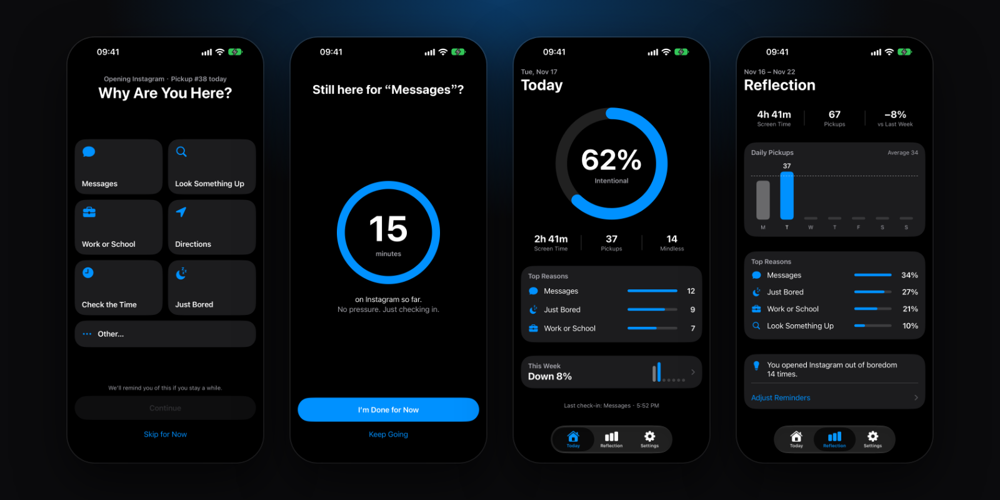

# Why Am I Here?

An iPhone app that asks one question before you open a distracting app: **why are you here?** You pick a reason, carry on, and get a gentle nudge if you are still there a while later. Over time it shows how many of your pickups had a purpose.

Built in SwiftUI from the "Why Am I Here? – Screen Sketches" Figma prototype.

## What it does

| Screen | What you see |
| --- | --- |
| **Intent Check** | "Why Are You Here?" with seven reasons (Messages, Look Something Up, Work or School, Directions, Check the Time, Just Bored, Other…). Continue takes you on to the app; Skip for Now lets you through without an answer; Never Mind keeps you out of it. |
| **Gentle Reminder** | A notification after N minutes in the app: "Still here for “Messages”?". Tapping it shows how long you have been there, with **I’m Done for Now** and **Keep Going**. |
| **Today** | Share of intentional pickups, screen time in watched apps, pickups, mindless pickups, top reasons, and this week's trend. |
| **Reflection** | The current week: pickups per day against the average, top reasons by share, change against last week, and one sentence about your habits. |
| **Settings** | Which apps to watch (with whether each one's automation works), asking on or off, how often to ask, the reminder interval, quiet hours, and sample data or a full reset. |

## How it works

iOS does not let one app intercept another. The supported way in is a **Shortcuts automation**: "when Instagram is opened, run this action". The app provides two actions for that:

- **Ask Why I’m Here** – run when a watched app is *opened*. It decides whether to ask (see [Settings](#settings)), and if so brings the Intent Check to the front. After you answer, the app sends you back to the watched app through its URL scheme.
- **Mark App Closed** – run when a watched app is *closed*. It ends the session, so screen time stops counting and pending reminders are cancelled.

Everything stays on the device. There is no account, no network access and no analytics.

## Build and install

Requirements: Xcode 27 or later (iOS 26 SDK or later), [XcodeGen](https://github.com/yonaskolb/XcodeGen) (`brew install xcodegen`), and an Apple developer team for device builds. The app runs on iOS 26 and later.

```sh
# 1. Signing: put your team ID and a bundle ID of your own in a local file (not committed)
cp Config/Signing.local.xcconfig.example Config/Signing.local.xcconfig
$EDITOR Config/Signing.local.xcconfig

# 2. Signed build, installed on the connected iPhone
scripts/build.sh install            # or: scripts/build.sh install <device-udid>

# Just the signed .ipa (build/WhyAmIHere.ipa)
scripts/build.sh ipa
```

To work in Xcode instead, run `xcodegen generate` and open `WhyAmIHere.xcodeproj`. The project file is generated from `project.yml` and is not committed.

## Set up the automations

Do this once for each watched app. The same steps are in the app under **Settings → Watched Apps → Set Up Automations**.

**Ask when it opens**

1. Open Shortcuts and go to the **Automation** tab.
2. Tap **+** and choose **App**.
3. Pick the app (for example Instagram), keep **Is Opened** checked, and choose **Run Immediately**.
4. Tap **Next**, then **New Blank Automation**.
5. Search for **Ask Why I’m Here**, add it, and set **App** to the same app.
6. Open the app to try it. Once it asks, **Settings → Watched Apps** shows it as *Working*.

**Stop the clock when it closes**

1. Create another **App** automation for the same app.
2. Check only **Is Closed**, and choose **Run Immediately**.
3. Add **Mark App Closed** and set **App** to the same app.

Without the second automation the app still works, but it cannot tell when you leave: a session is then counted up to the reminder interval, and reminders may arrive after you have left.

To see the flow without setting anything up, use **Settings → Watched Apps → Try a Check-In**. Nothing is recorded in that mode.

## Settings

| Setting | Behavior |
| --- | --- |
| Ask Why Before Watched Apps | Off: nothing is asked, but pickups and screen time are still counted. |
| How Often → Every Open | Asks every time. Default. |
| How Often → Every 3rd Open | Asks on the 1st, 4th, 7th… open of each app per day. |
| How Often → After 30+ Minutes Away | Asks only if you last left the app at least 30 minutes ago. |
| Remind Me in Watched Apps | Sends a reminder every N minutes of a session, up to four times. |
| Remind After (Minutes) | 5 to 60, in steps of 5. Default 15. |
| Watched Apps | 20 built-in apps plus any you add by name and URL scheme. Default: Instagram and TikTok. Each watched app shows whether its automation has reported an open yet. |
| Quiet Hours → Pause All Prompts | No questions and no reminders between From and To (default 10 PM to 7 AM). |
| Data → Load Sample Week | Replaces your history with the prototype's sample week, for demos and user testing. |
| Data → Erase All Data and Settings | Deletes every pickup and pending reminder and restores the default settings. |

## How the numbers are counted

- **Pickup** – one open of a watched app, whether or not you were asked.
- **Mindless** – you answered "Just Bored" or tapped Skip for Now.
- **Changed Your Mind** – you tapped Never Mind. It counts as a pickup but is neither mindless nor intentional.
- **Intentional %** – pickups with any other reason, as a share of pickups where you answered or skipped. Opens that were not asked about, and questions you walked away from, are left out.
- **Screen Time** – time from Continue (or from the open, when not asked) until the app is closed. It covers watched apps only; this is not the system-wide Screen Time figure.
- **vs Last Week** – pickups so far this week against the same weekdays of last week.

## Project layout

```
Core/                 Swift package: models, SwiftData store, check-in engine, statistics (no UI)
  Sources/WAIHCore/
  Tests/WAIHCoreTests/
App/                  SwiftUI app
  Views/              Today, Reflection, Settings, Watched Apps, setup guide, Intent Check, Gentle Reminder
  Intents/            App Intents used by Shortcuts
  AppModel.swift      App state and flow between screens
  NotificationManager.swift
UITests/              XCUITest flows
Config/               Build settings; Signing.local.xcconfig holds your team and bundle ID
scripts/build.sh      test / ipa / install / testflight
scripts/walkthrough.sh  screenshots of every usability-test task step
docs/design/usability-test/  test plan, session sheet, inspection report
scripts/make_icon.swift
project.yml           XcodeGen project definition
```

## Testing

```sh
scripts/build.sh test          # Core unit tests on the Mac, then UI tests on an iPhone simulator
swift test --package-path Core # unit tests only
scripts/walkthrough.sh /tmp/screens  # plays the usability-test tasks and saves a screenshot per step
```

The usability test for the course lives in [docs/design/usability-test](docs/design/usability-test): the [test plan](docs/design/usability-test/test-plan.md), a [session sheet](docs/design/usability-test/session-sheet.md) per participant, and the [inspection](docs/design/usability-test/inspection.md) done before it.

Launch arguments and deep links used by the tests, also handy for debugging:

| | |
| --- | --- |
| `-uiTesting` | In-memory data, throwaway settings, no notifications. |
| `-demoData` | Loads sample history matching the prototype (62% intentional, 37 pickups, 14 mindless, 2h 41m). |
| `-openURL <url>` | Opens a deep link right after launch. |
| `whyamihere://ask?app=<id>` | Same as the "Ask Why I’m Here" action. |
| `whyamihere://closed?app=<id>` | Same as "Mark App Closed". |
| `whyamihere://reminder` | Shows the Gentle Reminder for the running session. |
| `whyamihere://preview` | Starts the preview flow. |
| `whyamihere://today`, `reflection`, `settings` | Switches tab. |

Logs use the subsystem `whyamihere` (categories `engine`, `store`, `settings`, `notifications`, `intents`, `ui`):

```sh
log stream --predicate 'subsystem == "whyamihere"' --level info
```

## Known limits

- URL schemes for the built-in apps come from community documentation, not from Apple or the app makers. If one fails, the app says so and you switch back by hand; you can add the app again under **Your Apps** with a scheme that works.
- The check-in is a prompt, not a lock. Anyone can remove the automation or skip the question.
- Quiet hours are whole hours, and one window applies to every day.
